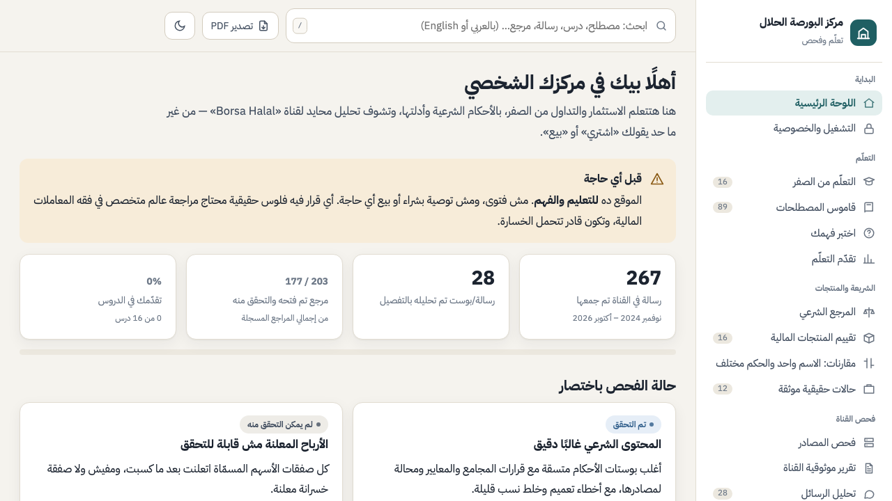

<h1 align="center">Hi, I'm Abdullah Rafat 👋</h1>
<h3 align="center">Mobile Developer · Flutter Developer @ ZAD Solutions</h3>

  I build production Flutter apps that people rely on every day — 
  HR platforms, geofenced attendance, payroll, real-time chat, with full English / Arabic (RTL).

  
  
  
  

---

### 🧑‍💻 About me

- 📱 **3+ years** shipping cross-platform mobile apps with **Flutter & Dart** (Android & iOS).
- 🏢 **Flutter Developer at [ZAD Solutions](https://www.zadsolutions.com)** — HR & attendance apps on an **Odoo** backend.
- 🎓 **Flutter Instructor at MASA Academy** — teaching Flutter and mentoring students on real projects.
- 🌍 Bilingual delivery: complete **Arabic (RTL)** support is a feature, not an afterthought.
- 🎓 B.Sc. Computer Science — Modern Academy (GPA 3.6), graduation project *Blind Assistant Glasses* (A+).
- 📍 Cairo, Egypt — open to full-time roles and freelance Flutter projects.

### 🛠️ Tech stack

  

| Area | Tools |
|---|---|
| **Mobile** | Flutter, Dart, Material 3, responsive layouts, animations |
| **State & architecture** | Bloc / Cubit, clean layering, dependency injection |
| **Backend & data** | Firebase (Auth, Firestore, Storage, FCM), Supabase, Odoo, REST with Dio, Hive |
| **Product features** | GPS geofencing, push notifications, localization & RTL, dark mode, real-time chat |
| **Also** | Python, Raspberry Pi & Arduino (robotics side project), static web (HTML / CSS / JS) |

### 🚀 Featured work

#### 🏭 El Sewedy · Sawa — Employee self-service HR app
Internal app for **El Sewedy Industries** employees: GPS-geofenced check-in/out, attendance log, payroll statements, leave requests and an org chart, with full English / Arabic (RTL).

`Flutter` `Cubit` `Dio` `Geolocation` · **[Case study →](https://dobydragon.github.io/elsewedy-sawa-portfolio/)**

  
  
  
  

#### 🏢 Zad HR — Bilingual multi-tenant HR platform
One app for many companies on an **Odoo** backend: attendance with location validation, leaves, payroll & payslips, loans with approval flow, and employee complaints.

`Flutter` `Bloc / Cubit` `Odoo` `Firebase` · **[Case study →](https://dobydragon.github.io/zad-hr-portfolio/)**

  
  
  
  

#### 🤝 Aman — Community & support platform for refugees and newcomers
Helps newcomers settle in: community groups with real-time chat, booking sessions with psychologists, a legal-rights guide and local help organizations, in **12 languages**.

`Flutter` `Firebase` `Realtime chat` `i18n / RTL` · **[Case study →](https://dobydragon.github.io/aman-portfolio/)**

  
  
  
  

#### 🐦 Tweety — Real-time social network
Twitter-style app: live feed with posts, likes and comments, direct messages, profiles with media upload, user search, email-verified auth, light & dark themes.

`Flutter` `Firebase` `Bloc / Cubit` · **[Case study →](https://dobydragon.github.io/tweety-portfolio/)**

  
  

#### 📈 Borsa Halal — Learn Sharia-compliant investing
Arabic learning hub for investing & trading with Islamic rulings: lessons from zero, an 89-term glossary, quizzes, product reviews and a source-checked analysis of a Telegram channel. Every claim links to its reference.

`HTML` `CSS` `JavaScript` · **[Live site →](https://dobydragon.github.io/borsa-halal/)**

#### 📖 Fatwa — Islamic-finance fatwa library
Arabic-first app to browse Sharia-board rulings on Islamic finance by topic, search them and read committee member profiles.

`Flutter` `Firebase` `Supabase` `Hive` · **[Repo →](https://github.com/dobydragon/fatwa)**

> 🐉 **Currently building:** *Dooby* — a robot driven by a Flutter app → Raspberry Pi 5 (Python) → Arduino motor controllers.

### 💼 Experience

- **ZAD Solutions** — Flutter Developer · *Jan 2025 – Present*
- **Arab DT** — Flutter Developer · *2024 – 2025*
- **MASA Academy** — Flutter Instructor (part-time) · *2024 – Present*

---

<i>Let's build something great — <a href="mailto:abdullahrrafat@gmail.com">abdullahrrafat@gmail.com</a></i>

